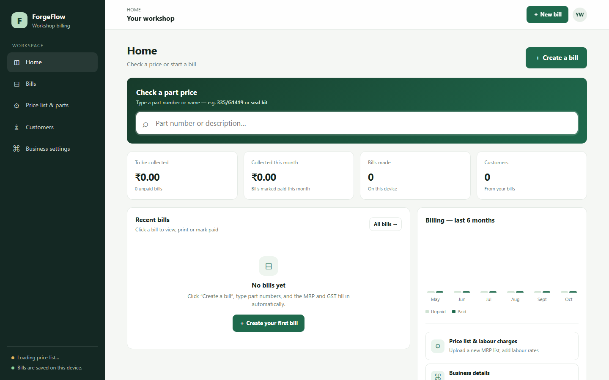

<div align="center">

# 🧾 ForgeFlow: Workshop Billing

### *Fast, simple GST billing for machine-parts workshops.*

A browser-based billing app with a **built-in price list of 65,000+ parts**. Type a part number, press Enter, and the MRP and GST fill in automatically.

[](https://digvijay165.github.io/machine-shop-billing/)


**[🌐 Live App](https://digvijay165.github.io/machine-shop-billing/)** · **[🐛 Report Bug](https://github.com/digvijay165/machine-shop-billing/issues)** · **[✨ Request Feature](https://github.com/digvijay165/machine-shop-billing/issues)**

<br>

<a href="https://digvijay165.github.io/machine-shop-billing/">
  
</a>

</div>

---

## 📖 About

**ForgeFlow** is billing software built for a real machine-parts workshop. It replaces handwritten bills and price-list lookups with a fast, clean web app that runs entirely in the browser: no server, no sign-up, no installation.

It ships with the **MRP June '25 price list (65,208 parts)**, creates proper **GST invoices**, remembers customers, and can share bills on **WhatsApp** in one click.

> 🔗 **Try it live:** [digvijay165.github.io/machine-shop-billing](https://digvijay165.github.io/machine-shop-billing/)

---

## ✨ Features

### ⚡ Billing
| Feature | Description |
| --- | --- |
| 🔍 **Instant part lookup** | Search 65,000+ parts by part number or description right from the Home page |
| ⌨️ **Type & Enter billing** | Enter a part number and the MRP and GST rate fill in automatically |
| ➕ **Smart quantities** | Adding the same part again increases its quantity |
| 🔧 **Labour & extras** | Add labour lines, discounts, and notes to any bill |
| 👥 **Customer memory** | Past customers' details fill in as you type their name |

### 🧾 GST Invoices
| Feature | Description |
| --- | --- |
| 💰 **GST-inclusive MRP** | MRP treated as tax-inclusive by default, with taxable value calculated |
| 🏛️ **CGST / SGST / IGST** | Correct tax split for intra-state and inter-state bills |
| 🔢 **Round off & amount in words** | Printed bills show round off and the total in words |
| 🖨️ **Print / PDF** | Print bills or save them as PDF |

### 📤 Sharing & Data
| Feature | Description |
| --- | --- |
| 💬 **WhatsApp & Email** | Share a bill summary in one click |
| 📊 **CSV export** | Export bills to CSV for accounts |
| 📥 **Excel price-list upload** | Upload next month's MRP list (`.xlsx` / `.csv`); it's read directly in the browser |
| 💾 **Backup & restore** | Move all bills and settings to another device |
| 📈 **Dashboard** | Pending and collected amounts, bill count, customers, and a 6-month billing chart |

---

## 🗂️ App Sections

| Section | What it does |
| --- | --- |
| 🏠 **Home** | Price checker, key stats, recent bills, and billing chart |
| 🧾 **Bills** | Create, edit, view, print, and mark bills as paid |
| ⚙️ **Price list & parts** | Built-in MRP list, Excel uploads, and labour charges |
| 👥 **Customers** | Customer list built automatically from your bills |
| 🏢 **Business settings** | Shop details, GST info, and backup / restore |

---

## 🛠️ Tech Stack

- **HTML5, CSS3, Vanilla JavaScript**: a single-page app with no frameworks
- **IndexedDB**: stores bills, customers, and uploaded price lists locally
- **Native Excel reader**: parses `.xlsx` in the browser using `DecompressionStream`, with no external libraries
- **JSON price list**: 65,208 parts bundled in `data/mrp-june-2025.json`
- **GitHub Pages**: static hosting

---

## 📁 Project Structure

```
machine-shop-billing/
├── index.html                 # The complete app (UI, styles, and logic)
├── data/
│   └── mrp-june-2025.json     # Built-in MRP price list (65,208 parts)
├── forgeflow-screenshot.png   # README preview image
└── README.md
```

---

## 🚀 Getting Started

### Use it online
Just open the **[live app](https://digvijay165.github.io/machine-shop-billing/)**. Nothing to install.

### Run locally

```bash
git clone https://github.com/digvijay165/machine-shop-billing.git
cd machine-shop-billing
python -m http.server 8000
```

Then open `http://localhost:8000`.

> 💡 Use a local server instead of opening `index.html` directly, so the browser can load the built-in price list from `data/`.

---

## 🔄 Updating the Price List

**Option 1: in the app (recommended).**
Go to **Price list & parts** and upload the new MRP Excel file (columns like *Material, Desc, MRP, GST rate*). It's saved in that browser and replaces the built-in list on that device.

**Option 2: replace the built-in list.**
Replace `data/mrp-june-2025.json` with a file of the same shape:

```json
{
  "name": "MRP June'25",
  "rows": [["partNo", "description", 1250, 18]]
}
```

If the file name changes, update `BUILT_IN_LIST` in `index.html`.

---

## 🔒 Data & Privacy

- All bills, customers, and settings are stored **only in the browser** on the device you use
- Uploaded price lists are read **locally** and kept in IndexedDB; **nothing is sent to any server**
- Use **Business settings → Download backup** to move your data to another device

> ⚠️ Clearing browser data will delete your bills. Download a backup regularly.

---

## 🌐 Deployment

| Setting | Value |
| --- | --- |
| Live URL | [digvijay165.github.io/machine-shop-billing](https://digvijay165.github.io/machine-shop-billing/) |
| Host | GitHub Pages |
| Source | `main` branch, `/ (root)` |
| Build command | *None* |

---

## 🗺️ Roadmap

- [ ] Cloud sync across devices
- [ ] Multi-user access for staff
- [ ] Stock / inventory tracking
- [ ] GST reports (GSTR-1 export)
- [ ] Installable offline app (PWA)

---

## 🤝 Contributing

Contributions, issues, and feature requests are welcome!

1. Fork the project
2. Create your branch (`git checkout -b feature/AmazingFeature`)
3. Commit your changes (`git commit -m "Add AmazingFeature"`)
4. Push to the branch (`git push origin feature/AmazingFeature`)
5. Open a Pull Request

---

## 👤 Author

**Digvijay Singh**
- GitHub: [@digvijay165](https://github.com/digvijay165)
- Portfolio: [digvijay165.github.io/portfolio](https://digvijay165.github.io/portfolio/)

---

<div align="center">

⭐ **If this project helped you, give it a star!** ⭐

Made with ❤️ by [Digvijay Singh](https://github.com/digvijay165)

</div>
